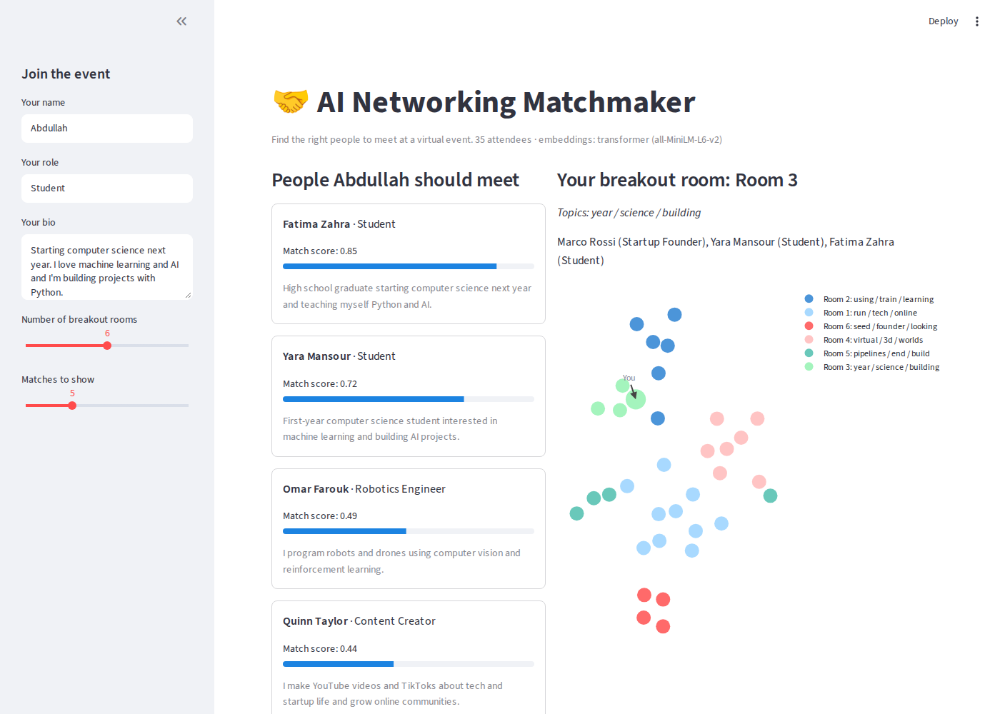
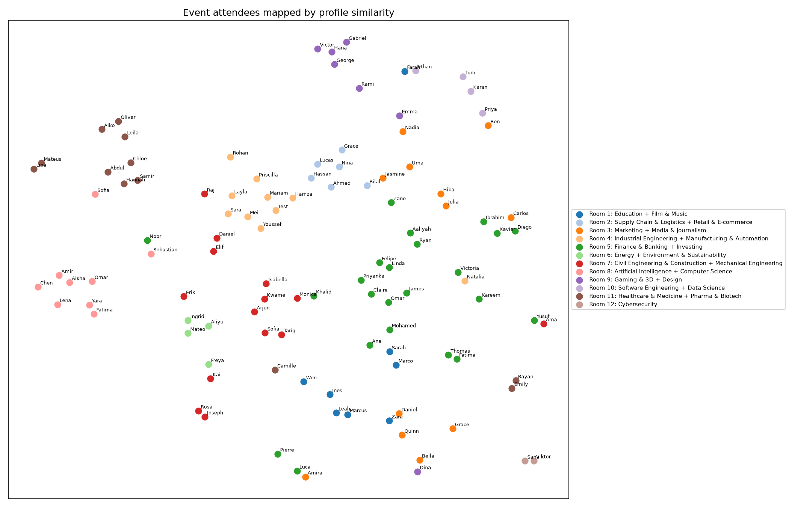

# 🤝 AI Networking Matchmaker

**Find the right people to meet at a virtual event, automatically.**

[](https://synk-matchmaker.streamlit.app)  **Live demo: [synk-matchmaker.streamlit.app](https://synk-matchmaker.streamlit.app)**. Add your own bio and see who you should meet.

Attendees fill in their field, interests and a short bio. The matchmaker uses NLP embeddings to understand what each person does, then:

- **Recommends who to meet**: each person's top matches, ranked by similarity
- **Creates breakout rooms**: groups attendees by topic with K-means clustering
- **Maps the event**: plots every attendee in 2D so you can see the communities

Built as a prototype feature for AI-powered virtual event platforms (conferences, trade shows and networking events), where helping people find each other is the hardest part.



---

## How it works

```
bios ──► embeddings ──► cosine similarity ──► top matches
                   ├──► K-means          ──► breakout rooms
                   └──► t-SNE            ──► 2D attendee map
```

| Step | What happens | Technique |
|---|---|---|
| 1. Embed | Each profile becomes a vector of numbers that captures its meaning. *Field + interests* and *bio* are embedded separately and weighted 60/40 | Sentence transformer [`all-MiniLM-L6-v2`](https://huggingface.co/sentence-transformers/all-MiniLM-L6-v2) (384 dimensions), with TF-IDF as an offline fallback |
| 2. Match | Every attendee is compared with every other attendee in one matrix multiplication | Cosine similarity |
| 3. Group | Attendees are split into topic-based breakout rooms, named after each room's most distinctive words | K-means clustering (unsupervised learning), silhouette score for evaluation |
| 4. Visualize | High-dimensional vectors are squashed to 2D while keeping neighbours close | t-SNE (PCA also supported) |
| 5. Serve | Visitors enter their own bio and instantly see matches, their room and their spot on the map | Streamlit + Plotly |

### Example matches

| Attendee | Top suggestion | Why it makes sense |
|---|---|---|
| Fintech startup founder | Fintech founder, then angel investor | Same space, plus someone who funds it |
| 3D artist | Game developer | Both build 3D worlds |
| Incoming CS student into AI | Two other AI-focused students, then an ML engineer | Peers first, then a mentor |

---

## Making it work for every field (Step 8)

**The problem:** while testing the live app, I entered an incoming *industrial engineering* student interested in *automation, logistics and operations*. Their top matches were **computer science students** (best score only 0.48). The bios only shared the phrase *"starting ... next year"*.

**Two causes, two fixes:**

1. **Biased data.** All 34 sample attendees worked in tech or startups, so there was nobody relevant to suggest. I expanded the event to **110 attendees across 48 fields**, including engineering, logistics, healthcare, law, finance, education, energy and the arts.
2. **Life stage drowned out the field.** Bios mix *what you do* with *where you are in life*. Each profile is now split into a **focus** part (field + interests) and an **about** part (bio). They're embedded separately and combined so that

   `similarity = 0.6 × similarity(focus) + 0.4 × similarity(bio)`

   This takes no extra model, just stacking the two unit vectors as `[√0.6·focus, √0.4·bio]`, so the cosine similarity of the stacked vectors equals the weighted sum.

I also added an honest **"no close matches yet"** message when even the best score is low, instead of presenting weak matches as good ones.

**Results for the same industrial engineering visitor** (transformer, 110 attendees):

| | Bio only | Weighted profile |
|---|---|---|
| #1 | Industrial Eng. student (0.72) | Supply Chain student (0.77) |
| #2 | Supply Chain student (0.64) | Industrial Eng. student (0.73) |
| #3 | **Civil** Eng. student (0.59) | **Industrial Engineer (0.67)** |
| #4 | Industrial Eng. student (0.50) | **Automation Engineer (0.64)** |
| #5 | Automation Engineer (0.44) | Industrial Eng. student (0.57) |

The weighting pushed out the civil engineering student, who matched only because of *"starting ... next year"*, and brought in two working professionals in the visitor's field, who are useful contacts for a student. Other fields now get sensible matches too: a doctor matches a hospital administrator, a medical student and a nurse, and a corporate lawyer matches a legal tech founder.

**Honest limitation:** with 12 rooms, K-means still makes one oversized "business" room (finance, law, HR, hospitality). Capping room sizes is on the to-do list.

---

## Results: keywords vs. meaning

I first built the pipeline with **TF-IDF** (keyword matching), then switched to a **sentence transformer**. Same attendees (the original 34), same code, different embeddings:

| Attendee | TF-IDF top match | Transformer top match |
|---|---|---|
| Aisha (computer vision ML engineer) | Robotics engineer (0.24). **Missed** the other computer vision engineer | **Amir, Computer Vision Engineer (0.72)** |
| Diego (fintech founder raising seed) | Fintech founder (0.31) | **Angel investor (0.72)**, then fintech founder and VC |
| Hana (3D artist) | Game dev (0.33), then weak matches (0.09) | Game dev, VR dev **and** technical artist (0.60–0.69) |
| Dina (event organizer, virtual events) | Near-zero scores (≤ 0.09) | **VR dev, 3D artist and community manager** (0.35–0.42) |

| Clustering quality | TF-IDF | Transformer |
|---|---|---|
| Silhouette score (higher = cleaner rooms) | 0.052 | **0.145** (≈ 3× better) |

*(These numbers are from the original 34-person dataset. The current 110-person results are in `outputs/results.txt`.)*

Aisha and Amir describe the same job in different words ("object detection" vs. "image recognition"). TF-IDF sees no shared keywords, but the transformer understands they mean the same thing.

### Attendee map

Every attendee plotted by bio similarity (t-SNE), coloured by breakout room:



Full output: [`outputs/results.txt`](outputs/results.txt). These results are regenerated automatically by a [GitHub Action](.github/workflows/generate-results.yml) whenever the code or data changes.

---

## What I learned

- **Keyword matching vs. meaning.** TF-IDF only matches exact words, so a "computer vision / object detection" engineer didn't match an "image recognition / CNN" engineer, even though they do the same job. Sentence transformers fix this because they encode meaning, not vocabulary.
- **Choosing k is a judgment call.** The silhouette score kept rising as rooms got smaller, so I picked the number of rooms that made sense for a real event, not just the highest score.
- **Test with real users.** Trying the app with an industrial engineering profile exposed a bias that never showed up in my tech-only test data. The fix came from the data and the features, not from a bigger model.
- **Always look at results.** The clustering and the 2D map sometimes disagreed (for example, an event organizer was clustered with founders but sat next to the 3D builders on the map). Inspecting both caught mistakes a single metric would hide.

---

## Run it yourself

```bash
git clone https://github.com/abdullahjawad115/synk-matchmaker.git
cd synk-matchmaker
pip install -r requirements.txt

python matchmaker.py      # prints matches and rooms, saves outputs/attendee_map.png
streamlit run app.py      # opens the web app in your browser
```

The first run downloads the embedding model (~80 MB). Without internet, it falls back to TF-IDF automatically.

## Project structure

```
├── app.py               # Streamlit web app
├── matchmaker.py        # Core ML: embeddings, matching, clustering, visualization
├── data/attendees.csv   # 110 sample attendees (name, role, field, stage, interests, bio)
├── outputs/             # Generated results, map and screenshot (by GitHub Actions)
├── scripts/             # Helper scripts (app screenshot)
└── requirements.txt
```

## Ideas for next steps

- [ ] LLM-generated icebreakers for each match ("You both work on computer vision. Ask about their drone project.")
- [ ] Learn from feedback: re-rank matches using 👍/👎 from attendees
- [ ] Match on goals as well as bios (e.g. *founder looking for investors* ↔ *investor looking for startups*)
- [ ] Balanced breakout rooms (cap room size so no room becomes a catch-all)
- [ ] Scale to thousands of attendees with a vector database

---

Built by **Abdullah Jawad**. [GitHub](https://github.com/abdullahjawad115)
